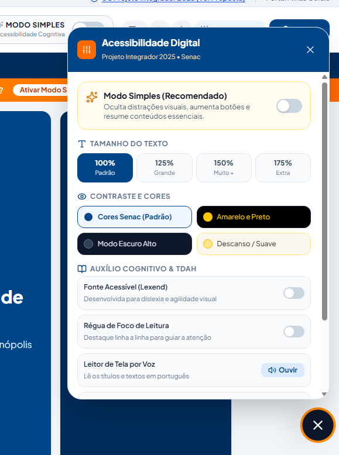

# UI alvo — Painel de Acessibilidade Digital

**Referência visual oficial do Projeto Integrador 2025 (Senac).**  
Este documento define o painel que o Modo Simples deve exibir (substituindo/evoluindo o menu radial atual).



---

## 1. Visão geral

| Aspecto | Definição |
| --- | --- |
| Tipo | Painel / modal lateral (overlay), scrollável |
| Abertura | FAB (botão flutuante) canto inferior direito |
| Fechamento | `X` no header, FAB com X, tecla `Esc`, clique fora (opcional) |
| Isolamento | Shadow DOM (manter princípio atual da lib) |
| Tom visual | Azul Senac + laranja de destaque; tipografia limpa (Lexend / sans) |
| Título | **Acessibilidade Digital** |
| Subtítulo | Projeto Integrador 2025 • Senac |

O FAB permanece visível na página; ao abrir o painel, o FAB pode virar “fechar” (X laranja), como no mockup.

---

## 2. Estrutura do painel (de cima para baixo)

```
┌─────────────────────────────────────┐
│ [ícone] Acessibilidade Digital   ✕  │  ← header azul escuro
│         Projeto Integrador 2025…    │
├─────────────────────────────────────┤
│ ★ Modo Simples (Recomendado)   [○]  │  ← card destaque amarelo
│   Oculta distrações…                │
├─────────────────────────────────────┤
│ T  TAMANHO DO TEXTO                 │
│ [100%] [125%] [150%] [175%]         │  ← segment control
├─────────────────────────────────────┤
│ 👁 CONTRASTE E CORES                │
│ [Senac] [Amarelo/Preto]             │  ← grid 2×2
│ [Escuro Alto] [Descanso/Suave]      │
├─────────────────────────────────────┤
│ 📘 AUXÍLIO COGNITIVO & TDAH         │
│ Fonte Acessível (Lexend)      [○]   │
│ Régua de Foco de Leitura      [○]   │
│ Leitor de Tela por Voz   [Ouvir]    │
│ … (mais opções se necessário)       │
└─────────────────────────────────────┘
```

---

## 3. Controles e comportamento

### 3.1 Header

| Elemento | Spec |
| --- | --- |
| Fundo | Azul escuro Senac (`#0B2C5F` / `#1B3F92` — alinhar marca) |
| Ícone | Quadrado laranja com “sliders” |
| Título | Branco, bold |
| Subtítulo | Branco/opaco menor |
| Fechar | Botão com `aria-label="Fechar painel de acessibilidade"` |

### 3.2 Modo Simples (Recomendado) — destaque

| Campo | Valor |
| --- | --- |
| Label | Modo Simples (Recomendado) |
| Descrição | Oculta distrações visuais, aumenta botões e resume conteúdos essenciais. |
| Controle | Toggle on/off |
| Visual | Fundo amarelo claro + borda laranja (único card “herói”) |
| Efeito | Ativa heurística atual: ocultar distrações, marcar conteúdo principal, tipografia/espçamento confortáveis, botões maiores |

> Este é o **toggle principal** do produto — deve ser o primeiro controle e o mais visível.

### 3.3 Tamanho do texto

Controle tipo **segmented buttons** (mutuamente exclusivos):

| Opção | Escala sugerida | Estado atual na lib |
| --- | --- | --- |
| 100% Padrão | `1` | default |
| 125% Grande | `1.25` | aproximar de `largerText` |
| 150% Muito + | `1.5` | **novo** (escala contínua) |
| 175% Extra | `1.75` | **novo** |

Selecionado: fundo azul escuro + texto branco.  
Demais: fundo cinza claro.

**Estado sugerido:** `options.textScale: '100' | '125' | '150' | '175'` (substitui o boolean `largerText`).

### 3.4 Contraste e cores

Grid 2×2 de temas (um ativo por vez):

| Tema | Aparência | Efeito na página |
| --- | --- | --- |
| Cores Senac (Padrão) | Claro, borda azul | Remove classes de tema |
| Amarelo e Preto | Fundo preto, texto amarelo | Alto contraste amarelo/preto |
| Modo Escuro Alto | Fundo escuro, texto claro | Dark high-contrast |
| Descanso / Suave | Creme / sépia | Baixa intensidade, menos cansaço visual |

**Estado sugerido:** `options.colorTheme: 'senac' | 'yellowBlack' | 'darkHigh' | 'soft'`  
(evolui o boolean `highContrast`).

### 3.5 Auxílio cognitivo & TDAH

| Controle | Tipo | Descrição no UI | Mapeamento técnico |
| --- | --- | --- | --- |
| Fonte Acessível (Lexend) | Toggle | Desenvolvida para dislexia e agilidade visual | Evolui `dyslexiaFont` → carregar/stack Lexend |
| Régua de Foco de Leitura | Toggle | Destaque linha a linha para guiar a atenção | **Novo** — overlay que segue o cursor/foco |
| Leitor de Tela por Voz | Botão **Ouvir** | Lê os títulos e textos em português | **Novo** — `speechSynthesis` (pt-BR) no `<main>` |

O mockup sugere scroll — outras opções já existentes na lib podem ficar **abaixo** nesta seção ou numa seção “Mais opções”:

| Extra (manter se couber) | Origem atual |
| --- | --- |
| Destacar links | `highlightLinks` |
| Espaçamento de texto | `textSpacing` |
| Reduzir movimento | `reducedMotion` |
| Ocultar imagens | `hideImages` |

---

## 4. Gap: UI atual × mockup

| Capacidade | Hoje (menu radial) | Mockup alvo |
| --- | --- | --- |
| Layout | Radial flutuante | Painel modal com seções |
| Modo Simples | Toggle no botão central | Card recomendado no topo |
| Texto | on/off “texto maior” | 4 níveis 100–175% |
| Contraste | on/off | 4 temas nomeados |
| Fonte dislexia | on/off | Toggle Lexend explícito |
| Régua de foco | ❌ | Toggle |
| TTS / Ouvir | ❌ | Botão |
| Branding PI/Senac | Genérico | Header “Acessibilidade Digital” |

**Conclusão:** a lib já cobre boa parte da *lógica*; falta **redesenhar a UI** e acrescentar régua + TTS + escalas/temas.

---

## 5. Modelo de estado alvo (rascunho)

```js
{
  modoSimples: false,
  panelOpen: false,
  options: {
    textScale: '100',          // '100' | '125' | '150' | '175'
    colorTheme: 'senac',       // 'senac' | 'yellowBlack' | 'darkHigh' | 'soft'
    dyslexiaFont: false,       // Lexend
    readingRuler: false,       // novo
    highlightLinks: false,
    textSpacing: false,
    reducedMotion: false,
    hideImages: false,
  },
  // TTS é ação pontual (não precisa persistir “ligado”)
}
```

Persistência: manter `localStorage` (já existe), incluindo `textScale` e `colorTheme`.

---

## 6. Tokens visuais (orientação)

| Token | Valor sugerido |
| --- | --- |
| `--ms-blue` | `#0B2C5F` / `#1B3F92` |
| `--ms-orange` | `#F5A623` / `#E8940A` |
| `--ms-simple-bg` | `#FFF8E7` |
| `--ms-simple-border` | `#F5A623` |
| `--ms-panel-radius` | `12–16px` |
| `--ms-font` | Lexend, system-ui, sans-serif |
| FAB tamanho | ~56–64px, canto inferior direito |
| Largura painel | ~360–400px (mobile: full width / quase full) |

---

## 7. Acessibilidade do próprio painel

- `role="dialog"`, `aria-modal="true"`, `aria-labelledby` no título
- Focus trap enquanto aberto; `Esc` fecha e devolve foco ao FAB
- Toggles com `aria-pressed` / `role="switch"` + `aria-checked`
- Segmented buttons: `role="radiogroup"` + `role="radio"`
- Temas: mesmo padrão radiogroup
- Contraste do texto do painel ≥ 4.5:1
- Anúncios curtos via `aria-live` ao ativar Modo Simples / tema / escala

---

## 8. Tasks de implementação (encaixe no plano)

Adicionar / priorizar na **Fase 2**:

| ID | Task | Prioridade |
| --- | --- | --- |
| F2-T08 | Redesenhar UI: FAB + painel modal conforme este mockup | P0 |
| F2-T09 | Estado `textScale` (100/125/150/175) + CSS | P0 |
| F2-T10 | Estado `colorTheme` (4 temas) + CSS | P0 |
| F2-T11 | Régua de foco de leitura | P1 |
| F2-T12 | Botão “Ouvir” (`speechSynthesis` pt-BR) | P1 |
| F2-T13 | Fonte Lexend no bundle/CDN + toggle | P1 |

Detalhes e aceite: ver [04-plano-implementacao.md](./04-plano-implementacao.md).

Chrome no header + faixa sob o nav (complementar a este painel): [07-ui-barra-modo-simples.md](./07-ui-barra-modo-simples.md).

---

## 9. Critério de aceite visual

- [ ] Painel reconhece-se como o mockup (header, card Modo Simples, seções)
- [ ] FAB laranja abre/fecha o painel
- [ ] Modo Simples em destaque e funcional
- [ ] Escalas de texto e 4 temas aplicáveis e persistentes
- [ ] Auxílios cognitivos presentes (Lexend; régua e Ouvir conforme prioridade)
- [ ] Navegação completa por teclado
- [ ] Não quebra o protótipo Senac (`examples/`)

---

## 10. Fora de escopo deste mockup (por enquanto)

- Extensão de browser / app nativo
- Resumo automático por IA dos conteúdos (“resume conteúdos”) — o MVP pode **priorizar conteúdo** via heurística; resumo gerativo fica P3
- Sincronização em nuvem de preferências
