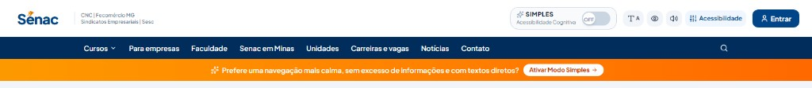

# UI alvo — Toggle no header + barra Modo Simples

**Referência visual do chrome Senac (header + faixa abaixo do nav).**  
Complementa o painel flutuante ([06-ui-painel-acessibilidade.md](./06-ui-painel-acessibilidade.md)): este documento cobre a **entrada rápida** no header e a **faixa de sessão** logo abaixo da navegação principal.

| Estado               | Mockup                                                                  |
| -------------------- | ----------------------------------------------------------------------- |
| Desativado (convite) |  |
| Ativado (sessão)     |    |

---

## 1. Visão geral

| Aspecto               | Definição                                                                                             |
| --------------------- | ----------------------------------------------------------------------------------------------------- |
| Toggle no header      | Controle **SIMPLES** na área superior direita (junto aos atalhos de a11y)                             |
| Barra de sessão       | Faixa **laranja** imediatamente **abaixo do `<nav>` principal**                                       |
| Visibilidade da barra | Sempre presente no protótipo Senac (conteúdo muda com o estado)                                       |
| Isolamento            | Preferência: injetado pela lib (Shadow DOM ou host controlado); no protótipo pode haver markup âncora |
| Tom                   | Laranja de destaque + tipografia limpa; alinhado aos tokens do doc 06                                 |

Controle único de ativação (sincronizado com o painel):

1. Toggle **SIMPLES** no header (com MS on, o mesmo controle vai para a faixa de pills)

Desligar: botão **Voltar ao site normal** na barra (estado ON), toggle **SIMPLES** off ou o switch do painel. Ativar: botão **Ativar Modo Simples** na barra (estado OFF), toggle **SIMPLES** ou o switch do painel. **Decisão de 2026-11-16** (supera a versão anterior desta seção, que não previa CTA nem “Voltar”): ver §9.

---

## 2. Header — controle SIMPLES

### 2.1 Estado OFF

| Elemento  | Spec                                            |
| --------- | ----------------------------------------------- |
| Label     | **SIMPLES** (bold, uppercase)                   |
| Subtítulo | `Acessibilidade Cognitiva`                      |
| Controle  | Switch `role="switch"` — `aria-checked="false"` |
| Ícone     | Estrela / sparkle à esquerda do grupo           |
| Contorno  | Pill neutro (sem destaque amarelo)              |

Atalhos vizinhos (mesmo bloco do header — protótipo / painel):

| Controle                 | Papel                                                 |
| ------------------------ | ----------------------------------------------------- |
| Ícone `T A`              | Atalho tamanho de texto (abre painel ou ciclo rápido) |
| Ícone olho               | Atalho contraste / visão                              |
| Ícone alto-falante       | Atalho TTS / ouvir                                    |
| Botão **Acessibilidade** | Abre o painel do doc 06 (FAB equivalente no chrome)   |

### 2.2 Estado ON

| Elemento  | Spec                                                      |
| --------- | --------------------------------------------------------- |
| Label     | **SIMPLES**                                               |
| Subtítulo | `Interface Simplificada`                                  |
| Switch    | `aria-checked="true"`                                     |
| Contorno  | Pill com borda/amarelo de destaque (estado ativo visível) |

---

## 3. Barra abaixo do nav

Posição: **logo abaixo** da barra de navegação azul (Cursos, Contato, etc.).

### 3.1 Estado OFF — convite

```
┌──────────────────────────────────────────────────────────────────────────┐
| ★ Prefere uma navegação mais calma…? Use o interruptor SIMPLES no menu.  |
└──────────────────────────────────────────────────────────────────────────┘
```

| Campo | Valor                                                                                                     |
| ----- | --------------------------------------------------------------------------------------------------------- |
| Fundo | Laranja sólido (token `--ms-orange` / alinhado à marca)                                                   |
| Texto | Convite + instrução para usar o interruptor **SIMPLES** no menu                                           |
| CTA   | Botão **Ativar Modo Simples** dentro da barra (alvo ≥ 44 px, teclado) — convite com no máximo 12 palavras |

### 3.2 Estado ON — sessão ativa

```
┌────────────────────────────────────────────────────────────────────────────┐
| [★] Modo Simples Ativado  [Foco na Navegação]                               |
|     Exibindo explicações em palavras fáceis, sem termos complicados.        |
|     [Ouvir Página] [Linguagem Simples: LIGADA] [Imagens: OCULTAS|VISÍVEIS]  |
└────────────────────────────────────────────────────────────────────────────┘
```

| Elemento                    | Spec                                                                                                            |
| --------------------------- | --------------------------------------------------------------------------------------------------------------- |
| Título                      | **Modo Simples Ativado**                                                                                        |
| Badge                       | Pill escuro: **Foco na Navegação**                                                                              |
| Descrição                   | Exibindo explicações em palavras fáceis… (ou copy sem linguagem simples)                                        |
| Botão **Ouvir Página**      | Branco; ícone alto-falante; TTS do conteúdo principal                                                           |
| Botão **Linguagem Simples** | Escuro; estado **LIGADA** / **DESLIGADA**                                                                       |
| Botão **Imagens**           | Escuro; **OCULTAS** / **VISÍVEIS** (`hideImages`)                                                               |
| Desligar MS                 | Botão **Voltar ao site normal** (≥ 44 px, chama `disable()`); também o switch **SIMPLES** ou o switch do painel |

---

## 4. Comportamento e sincronização

| Evento               | Efeito                                                                                      |
| -------------------- | ------------------------------------------------------------------------------------------- |
| Toggle SIMPLES → on  | Ativa Modo Simples; barra passa ao estado ON; anúncio `aria-live`; switch vai para as pills |
| Toggle SIMPLES → off | Desativa; barra volta ao OFF; switch volta ao header; reverte mutações                      |
| “Ouvir Página”       | Lê `<main>` / bloco principal (mesmo motor do painel); highlight por bloco                  |
| “Linguagem Simples”  | Liga/desliga opção; label LIGADA/DESLIGADA                                                  |
| “Imagens”            | Alterna `hideImages`; preferência “mostrar no MS” é lembrada                                |
| Persistência         | Mesmo `localStorage` / state da lib (`modoSimples` + options)                               |

O card **Modo Simples** do painel (doc 06) e estes controles são a **mesma fonte de verdade** de estado.

---

## 5. Acessibilidade

- Switch e botões com nomes acessíveis (`aria-label` quando o visual for só ícone)
- Barra: região com `role="region"` + `aria-label="Modo Simples"` (ou landmark equivalente)
- Contraste texto/botões ≥ 4.5:1 sobre o laranja
- Ordem de foco: header toggle → barra → conteúdo
- Não remover nós do DOM ao ativar (princípio não destrutivo da lib)

---

## 6. Gap vs. plano anterior

| Capacidade            | Antes (só doc 06) | Implementação atual                                              |
| --------------------- | ----------------- | ---------------------------------------------------------------- |
| Entrada no header     | ❌ (só FAB)       | Toggle **SIMPLES**                                               |
| Faixa abaixo do nav   | ❌                | Barra off/on                                                     |
| Ativação              | —                 | Botão **Ativar Modo Simples** na barra, switch SIMPLES ou painel |
| Ações na sessão ativa | Só no painel      | Ouvir · Linguagem · Imagens                                      |
| Badge de status       | ❌                | **Foco na Navegação**                                            |

---

## 7. Tasks (encaixe no plano)

| ID     | Task                                                    | Prioridade |
| ------ | ------------------------------------------------------- | ---------- |
| F2-T14 | Toggle SIMPLES no header + barra abaixo do nav (off/on) | P0         |
| F2-T15 | Botões da sessão ativa (Ouvir, Linguagem, Imagens)      | P0         |

Detalhes e aceite: [04-plano-implementacao.md](./04-plano-implementacao.md).  
Integração/API: [09-guia-integracao.md](./09-guia-integracao.md).

---

## 8. Critério de aceite visual

- [ ] Toggle SIMPLES visível no header (off/on distintos)
- [ ] Com MS on, o mesmo switch aparece nas pills (header some como distração)
- [ ] Barra laranja logo abaixo do nav nos dois estados
- [ ] OFF: convite curto (≤ 12 palavras) + botão **Ativar Modo Simples** na barra
- [ ] ON: título, badge, descrição, Ouvir / Linguagem / Imagens e **Voltar ao site normal**
- [ ] Toggle e painel sincronizados com o estado global
- [ ] Não regressa o painel (doc 06) nem o protótipo `examples/`

---

## 9. Decisão de 2026-11-16 (F0): saída e ativação dentro da barra

| Item       | Antes (§3, §8)                                                               | Agora                                                                                                      |
| ---------- | ---------------------------------------------------------------------------- | ---------------------------------------------------------------------------------------------------------- |
| Estado ON  | Sem “Voltar”; saída só pelo switch (escondido entre as pills) ou pelo painel | Botão **Voltar ao site normal** na barra; ao acionar, o foco vai para o botão **Ativar Modo Simples**      |
| Estado OFF | Só texto apontando o interruptor no menu                                     | Convite curto + botão **Ativar Modo Simples**; ao acionar, o foco vai para o título “Modo Simples Ativado” |

**Motivo:** controle de saída explícito e descoberta da ativação para o público-alvo (baixa familiaridade com tecnologia, doc/01). A barra só existe com `sessionBar` ativo (ver doc/09). Achados UX-18 e UX-20. Estende o conflito `doc/07` §8 × `doc/12` §2 a favor de `doc/12`.
