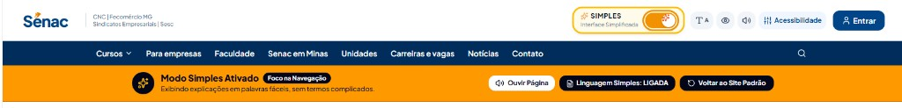

# UI alvo — Toggle no header + barra Modo Simples

**Referência visual do chrome Senac (header + faixa abaixo do nav).**  
Complementa o painel flutuante ([06-ui-painel-acessibilidade.md](./06-ui-painel-acessibilidade.md)): este documento cobre a **entrada rápida** no header e a **faixa de sessão** logo abaixo da navegação principal.

| Estado | Mockup |
| --- | --- |
| Desativado (convite) |  |
| Ativado (sessão) |  |

---

## 1. Visão geral

| Aspecto | Definição |
| --- | --- |
| Toggle no header | Controle **SIMPLES** na área superior direita (junto aos atalhos de a11y) |
| Barra de sessão | Faixa **laranja** imediatamente **abaixo do `<nav>` principal** |
| Visibilidade da barra | Sempre presente no protótipo Senac (conteúdo muda com o estado) |
| Isolamento | Preferência: injetado pela lib (Shadow DOM ou host controlado); no protótipo pode haver markup âncora |
| Tom | Laranja de destaque + tipografia limpa; alinhado aos tokens do doc 06 |

Dois pontos de ativação (devem permanecer sincronizados):

1. Toggle **SIMPLES** no header  
2. CTA **Ativar Modo Simples** na barra (estado off)

Desligar: toggle off **ou** botão **Voltar ao Site Padrão** na barra (estado on).

---

## 2. Header — controle SIMPLES

### 2.1 Estado OFF

| Elemento | Spec |
| --- | --- |
| Label | **SIMPLES** (bold, uppercase) |
| Subtítulo | `Acessibilidade Cognitiva` |
| Controle | Switch `role="switch"` — `aria-checked="false"` |
| Ícone | Estrela / sparkle à esquerda do grupo |
| Contorno | Pill neutro (sem destaque amarelo) |

Atalhos vizinhos (mesmo bloco do header — protótipo / painel):

| Controle | Papel |
| --- | --- |
| Ícone `T A` | Atalho tamanho de texto (abre painel ou ciclo rápido) |
| Ícone olho | Atalho contraste / visão |
| Ícone alto-falante | Atalho TTS / ouvir |
| Botão **Acessibilidade** | Abre o painel do doc 06 (FAB equivalente no chrome) |

### 2.2 Estado ON

| Elemento | Spec |
| --- | --- |
| Label | **SIMPLES** |
| Subtítulo | `Interface Simplificada` |
| Switch | `aria-checked="true"` |
| Contorno | Pill com borda/amarelo de destaque (estado ativo visível) |

---

## 3. Barra abaixo do nav

Posição: **logo abaixo** da barra de navegação azul (Cursos, Contato, etc.).

### 3.1 Estado OFF — convite

```
┌──────────────────────────────────────────────────────────────────────────┐
| ★ Prefere uma navegação mais calma, sem excesso de informações…?  [CTA] |
└──────────────────────────────────────────────────────────────────────────┘
```

| Campo | Valor |
| --- | --- |
| Fundo | Laranja sólido (token `--ms-orange` / alinhado à marca) |
| Texto | Prefere uma navegação mais calma, sem excesso de informações e com textos diretos? |
| CTA | Botão branco, texto laranja: **Ativar Modo Simples →** |
| Ação do CTA | `modoSimples = true` (mesmo efeito do toggle) |

### 3.2 Estado ON — sessão ativa

```
┌────────────────────────────────────────────────────────────────────────────┐
| [★] Modo Simples Ativado  [Foco na Navegação]                               |
|     Exibindo explicações em palavras fáceis, sem termos complicados.        |
|                          [Ouvir Página] [Linguagem Simples: LIGADA] [Voltar]|
└────────────────────────────────────────────────────────────────────────────┘
```

| Elemento | Spec |
| --- | --- |
| Título | **Modo Simples Ativado** |
| Badge | Pill escuro: **Foco na Navegação** |
| Descrição | Exibindo explicações em palavras fáceis, sem termos complicados. |
| Botão **Ouvir Página** | Branco; ícone alto-falante; dispara TTS do conteúdo principal (liga com F2-T12) |
| Botão **Linguagem Simples** | Escuro; estado **LIGADA** / **DESLIGADA**; toggle de linguagem simplificada (MVP: priorização/heurística; copy “palavras fáceis”) |
| Botão **Voltar ao Site Padrão** | Escuro; ícone seta circular; `modoSimples = false` |

---

## 4. Comportamento e sincronização

| Evento | Efeito |
| --- | --- |
| Toggle SIMPLES → on | Ativa Modo Simples; barra passa ao estado ON; anúncio `aria-live` |
| CTA “Ativar Modo Simples” | Idem |
| Toggle → off **ou** “Voltar ao Site Padrão” | Desativa; barra volta ao estado OFF; reverte mutações |
| “Ouvir Página” | Lê `<main>` / bloco principal (mesmo motor do painel) |
| “Linguagem Simples” | Liga/desliga opção dedicada; label reflete LIGADA/DESLIGADA |
| Persistência | Mesmo `localStorage` / state da lib (`modoSimples` + opção de linguagem) |

O card **Modo Simples** do painel (doc 06) e estes controles são a **mesma fonte de verdade** de estado.

---

## 5. Acessibilidade

- Switch e botões com nomes acessíveis (`aria-label` quando o visual for só ícone)
- Barra: região com `role="region"` + `aria-label="Modo Simples"` (ou landmark equivalente)
- Contraste texto/botões ≥ 4.5:1 sobre o laranja
- Ordem de foco: header toggle → barra → conteúdo
- Não remover nós do DOM ao ativar (princípio não destrutivo da lib)

---

## 6. Gap vs. plano anterior

| Capacidade | Antes (só doc 06) | Este mockup |
| --- | --- | --- |
| Entrada no header | ❌ (só FAB) | Toggle **SIMPLES** |
| Faixa abaixo do nav | ❌ | Barra off/on |
| CTA de ativação na página | ❌ | **Ativar Modo Simples →** |
| Ações na sessão ativa | Só no painel | Ouvir · Linguagem Simples · Voltar |
| Badge de status | ❌ | **Foco na Navegação** |

---

## 7. Tasks (encaixe no plano)

| ID | Task | Prioridade |
| --- | --- | --- |
| F2-T14 | Toggle SIMPLES no header + barra abaixo do nav (off/on) | P0 |
| F2-T15 | Botões da sessão ativa (Ouvir, Linguagem Simples, Voltar) | P0 |

Detalhes e aceite: [04-plano-implementacao.md](./04-plano-implementacao.md).

---

## 8. Critério de aceite visual

- [ ] Toggle SIMPLES visível no header (off/on distintos)
- [ ] Barra laranja logo abaixo do nav nos dois estados
- [ ] OFF: texto de convite + CTA Ativar
- [ ] ON: título, badge, descrição e três botões de ação
- [ ] Toggle, CTA e “Voltar” sincronizados com o estado global
- [ ] Não regressa o painel (doc 06) nem o protótipo `examples/`
