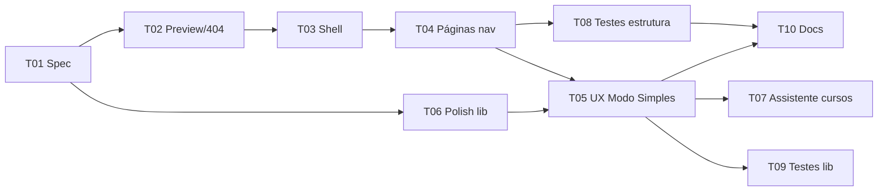

# Plano Fase 5 — Melhorias UX, páginas e Modo Simples

Plano operacional em **tasks** para deixar o protótipo Senac Minas e o Modo Simples **agradáveis, claros e simples** — alinhados à proposta do PI e à referência visual (mockups + zip `senac-minas---protótipo-modo-simples`).

Documentos: [plano F0–F4](./04-plano-implementacao.md) · [status](./03-status-implementacao.md) · [barra](./07-ui-barra-modo-simples.md) · [painel](./06-ui-painel-acessibilidade.md) · [inventário](./05-inventario-prototipo.md)

Referência externa (não versionar no git):

- Zip: `Downloads/senac-minas---protótipo-modo-simples.zip`
- Extração local de estudo (opcional): `_ref-prototipo-senac/` (ignorada pelo `.gitignore`)

---

## 1. Objetivo

Entregar uma demo em que:

1. **As páginas** pareçam um site institucional coerente (não “HTML cru” / assets quebrados).
2. **Cada seção** do fluxo Modo Simples seja uma **opção real de navegação** (página ou âncora estável).
3. **O Modo Simples** mude a experiência de forma óbvia: menos ruído, hub de ações, linguagem clara, barra laranja + pills — **bonito e simples**.
4. **Testes** garantam a estrutura (nav, links, semântica, script, estados da lib).

Público: quem se beneficia de menos sobrecarga cognitiva (proposta do PI).

---

## 2. Diagnóstico (a partir das capturas + código atual)

| Problema observado                                                        | Causa provável                                            | Impacto                                           |
| ------------------------------------------------------------------------- | --------------------------------------------------------- | ------------------------------------------------- |
| Listing em `localhost:8765/` sem entrar em `/examples/`                   | Preview na raiz; URL errada na demo                       | “Site quebrado” na primeira impressão             |
| 404 em `/contato`, `/cursos`, `/pesquisa` e redirect `.html` → path limpo | Servidor / caminhos fora de `examples/`                   | Páginas internas inacessíveis                     |
| 404 `CSS/reset.css`                                                       | CSS pedido na raiz, não em `examples/CSS/`                | Home sem estilo                                   |
| Nav da home com itens mortos (`Para Empresas`, etc.)                      | Spans decorativos sem página                              | Incompleto vs referência                          |
| Nav diferente entre home e internas                                       | Dois shells CSS                                           | Visual inconsistente                              |
| Modo Simples só “esconde ruído”                                           | Lib muta DOM; **não** monta hub/cards/pills da referência | Experiência fraca vs mockup                       |
| FAB / barra aquém do mockup                                               | Chrome parcial                                            | Pouca identidade “SIMPLES”                        |
| Referência React (Vite)                                                   | App paralelo, não injetável                               | Usar só como **spec visual/UX**, não portar stack |

### O que a referência faz bem (copiar o _comportamento_, não o React)

| Padrão                        | Detalhe                                                                 |
| ----------------------------- | ----------------------------------------------------------------------- |
| Toggle SIMPLES no header      | Estado ON/OFF visível (“Interface Simplificada”)                        |
| Barra âmbar                   | Off = convite; On = status + Ouvir / Linguagem / Voltar                 |
| **Nav pills do Modo Simples** | Início · Cursos · PSG · Unidades · Atendente · Área do Aluno            |
| Hub “O que precisa?”          | Cartões grandes (OPÇÃO 1…N) com 1 ação cada                             |
| Conteúdo por seção            | Assistente de cursos, PSG em 3 passos, unidades, contato humano         |
| FAB                           | Círculo laranja + ícone de ajustes; tip “Acessibilidade & Modo Simples” |

### Princípios (herdados + novos)

| Princípio       | Regra                                                                          |
| --------------- | ------------------------------------------------------------------------------ |
| Lib ≠ site      | Conteúdo Senac em `examples/`; lib em `src/`                                   |
| Não destrutivo  | Classes/`data-ms-*`; reversível                                                |
| HTML semântico  | `header` / `nav` / `main` / `footer`                                           |
| Um job por tela | No Modo Simples: hub ou uma seção, não dashboard denso                         |
| Referência = UX | Tokens Senac (`#004587`, âmbar/laranja), cards, pills — sem Tailwind no bundle |

---

## 3. Mapa de navegação alvo

### 3.1 Site padrão (sempre no `<nav>` principal)

| Label           | Arquivo                  | Notas                                |
| --------------- | ------------------------ | ------------------------------------ |
| Início          | `examples/index.html`    | Hub + destaques                      |
| Sobre Nós       | `examples/sobrenos.html` | Projeto / instituição                |
| Cursos          | `examples/cursos.html`   | Lista + filtros simples              |
| Gratuitos (PSG) | `examples/psg.html`      | **Novo**                             |
| Unidades        | `examples/unidades.html` | **Novo**                             |
| Contato         | `examples/contato.html`  | Atendente / WhatsApp / form          |
| Área do Aluno   | `examples/aluno.html`    | **Novo** (explicativo + CTA externo) |
| Pesquisar       | `examples/pesquisa.html` | Busca mínima                         |

Itens só decorativos da home antiga **saem** ou viram links reais acima. Nada de span “falso link”.

### 3.2 Nav do Modo Simples (pills — espelha as seções)

Quando `modoSimples` / `html.ms-ativo`:

| Pill                        | Destino                    | Conteúdo no estilo da referência |
| --------------------------- | -------------------------- | -------------------------------- |
| Início / O que precisa?     | `index.html` (+ bloco hub) | Cartões de ação                  |
| Cursos Disponíveis          | `cursos.html`              | Assistente + lista clara         |
| Cursos 100% Gratuitos (PSG) | `psg.html`                 | 3 passos + vagas                 |
| Onde tem Senac?             | `unidades.html`            | Cidade + cards de unidade        |
| Falar com Atendente         | `contato.html`             | Contato humano, sem “robô”       |
| Área do Aluno               | `aluno.html`               | Boletos/notas (orientação)       |

**Implementação preferida:** markup nas páginas + CSS ativado por `html.ms-ativo` (ou classe no `body`). A lib continua responsável por: estado, chrome (toggle/barra), painel, mutação leve de distrações, TTS/linguagem. Opcional P2: componente `simpleNav.js` que injeta as pills a partir de config, para sites externos.

---

## 3.3 Decisões congeladas — F5-T01 (2026-09-10)

### Páginas aprovadas (mapa final do protótipo)

| #   | Label nav       | Arquivo                  | Status F5-T01              |
| --- | --------------- | ------------------------ | -------------------------- |
| 1   | Início          | `examples/index.html`    | Existe — polish em T03/T05 |
| 2   | Sobre Nós       | `examples/sobrenos.html` | Existe — unificar shell    |
| 3   | Cursos          | `examples/cursos.html`   | Existe — assistente em T07 |
| 4   | Gratuitos (PSG) | `examples/psg.html`      | **Criar em T04**           |
| 5   | Unidades        | `examples/unidades.html` | **Criar em T04**           |
| 6   | Contato         | `examples/contato.html`  | Existe — unificar shell    |
| 7   | Área do Aluno   | `examples/aluno.html`    | **Criar em T04**           |
| 8   | Pesquisar       | `examples/pesquisa.html` | Existe — unificar shell    |

**Fora do nav (não criar página):** Para Empresas, Faculdade, Notícias como itens de menu. Notícias pode ser bloco resumido só no hub MS (opcional P3), sem item de nav.

**Sobre Nós:** permanece no nav do site padrão; no hub MS pode aparecer como cartão “Sobre esta acessibilidade / projeto” (link para `sobrenos.html`), sem pill dedicada (pills = seção 3.2).

### Tokens CSS

Fonte canônica do protótipo: [`examples/CSS/tokens.css`](../examples/CSS/tokens.css).

| Token                               | Valor                 | Uso                           |
| ----------------------------------- | --------------------- | ----------------------------- |
| `--senac-blue`                      | `#004587`             | Nav ativa, pills ON, links    |
| `--senac-blue-deep`                 | `#002d5b`             | Blocos escuros / CTAs         |
| `--ms-blue` / `--ms-blue-mid`       | `#0B2C5F` / `#1B3F92` | Header painel (doc 06)        |
| `--ms-orange` / `--ms-orange-brand` | `#F5A623` / `#F39200` | FAB, destaques                |
| `--ms-amber-bar`                    | `#F59E0B`             | Barra de sessão MS            |
| `--ms-simple-bg`                    | `#FFF8E7`             | Card “Modo Simples” no painel |
| `--ms-font`                         | Lexend + system sans  | Protótipo + painel            |
| `--ms-radius` / `--ms-radius-xl`    | `12px` / `24px`       | Botões / cards hub            |
| `--ms-fab-size`                     | `56px`                | FAB circular                  |
| `--ms-content-max`                  | `72rem`               | Largura do conteúdo           |

Lib (`src/ui/styles.js`) já usa `--ms-*` equivalentes; T06 alinha laranja de marca (`#f39200`) se necessário.

### Decisão: onde mora o hub do Modo Simples

| Opção                                               | Escolha               |
| --------------------------------------------------- | --------------------- |
| **A — Markup em `examples/` + CSS `html.ms-ativo`** | **Aprovada (F5-T01)** |
| B — Só CSS genérico na lib (sem hub Senac)          | Rejeitada para o PI   |
| C — Portar React do zip                             | Fora de escopo        |

**Motivo:** o hub (cartões OPÇÃO 1…N), pills e textos PSG/unidades são **conteúdo do protótipo Senac**, não da biblioteca injetável. A lib fornece estado (`modoSimples` → `html.ms-ativo`), chrome, painel, mutator e TTS. Classes de convenção no protótipo:

| Classe / atributo                      | Papel                               |
| -------------------------------------- | ----------------------------------- |
| `html.ms-ativo`                        | MS ligado (já usado pela lib)       |
| `.ms-simple-only`                      | Visível só com MS                   |
| `.ms-simple-hide`                      | Escondido com MS (carrossel, ruído) |
| `.ms-hub`                              | Grid de cartões na home             |
| `nav[data-ms-pills]`                   | Nav pills (T05)                     |
| `[data-ms-plain]` / `[data-ms-simple]` | Pares de texto (linguagem simples)  |

P2 (T11): `simpleNav` na lib para sites externos — não bloqueia o protótipo.

---

## 4. Arquitetura da melhoria (lib × protótipo)

```
┌─────────────────────────────────────────────────────────┐
│  src/ (biblioteca injetável)                            │
│  · sessionChrome (toggle + barra) — polish visual       │
│  · fab + a11yPanel — ícones/estados do mockup           │
│  · mutator — esconder banners/ruído no site padrão      │
│  · (P2) simpleNav — pills reutilizáveis                 │
└──────────────────────────┬──────────────────────────────┘
                           │ classes html.ms-ativo
┌──────────────────────────▼──────────────────────────────┐
│  examples/ (protótipo Senac)                            │
│  · shell único (header/nav/footer + CSS tokens)         │
│  · páginas por seção                                    │
│  · blocos .ms-hub / .ms-simple-only visíveis no MS      │
│  · site “rico” escondido ou simplificado no MS          │
└─────────────────────────────────────────────────────────┘
```

Não reescrever o repo em React/Vite da referência.

---

## 5. Fases e tasks

Convenção: `F5-T{n}` · Prioridade P0–P3 · Aceite com checklist.

Critério de fase: todos P0/P1 com aceite + testes estruturais verdes + status atualizado.

---

### F5-T01 — Congelar spec visual e inventário de gaps

- **Prioridade:** P0
- **Depende de:** —
- **Descrição:** Registrar gaps (seção 2) e tokens (cores, raios, tipografia) a partir da referência + docs 06/07. Decidir lista final de páginas (seção 3).
- **Aceite:**
  - [x] Tabela de páginas aprovada pela equipe
  - [x] Tokens CSS listados neste doc ou em `examples/CSS/tokens.css`
  - [x] Decisão explícita: hub do MS = markup em `examples` (recomendado) vs só CSS genérico da lib
- **Saída:** este plano revisado + inventário atualizado
- **Concluído em:** 2026-09-10 — decisões na §3.3; tokens em `examples/CSS/tokens.css`; inventário em [05-inventario-prototipo.md](./05-inventario-prototipo.md)

---

### F5-T02 — Entrada da demo e caminhos (zero 404)

- **Prioridade:** P0
- **Depende de:** T01
- **Descrição:** Garantir que `npm run preview` leve à home correta; README com URL canônica `…/examples/index.html`. Opcional: `examples/index` redirect na raiz via script ou página `index.html` na raiz apontando para examples. Verificar que todos os `href` de CSS/img/script resolvem sob `/examples/`.
- **Aceite:**
  - [x] Nenhum 404 de CSS/img nas páginas do mapa (smoke manual ou teste)
  - [x] README / pacote de entrega com URL certa
  - [x] Não depender de “pretty URLs” sem arquivo
- **Saída:** preview confiável
- **Concluído em:** 2026-09-10 — `index.html` raiz, `serve.json` (`cleanUrls: false`), `npm run smoke:examples`

---

### F5-T03 — Shell visual único do protótipo

- **Prioridade:** P0
- **Depende de:** T02
- **Descrição:** Unificar header, nav, footer e tipografia em todas as páginas (`CSS` compartilhado). Home deixa de parecer “lista crua”; slides/imagens com `alt` e paths `img/` canônicos. Visual: azul Senac + âmbar, espaço generoso, sem cards desnecessários fora do hub MS.
- **Aceite:**
  - [x] Mesmo bloco de nav (links reais) em todas as páginas HTML do mapa
  - [x] `aria-current="page"` na página ativa
  - [x] Home legível em desktop e mobile (nav scrollable se preciso)
- **Saída:** `examples/CSS/` consolidado + HTMLs alinhados
- **Concluído em:** 2026-09-10 — `tokens.css` + `shell.css` + `pages.css`; 5 páginas no mesmo shell (nav completa PSG/Unidades/Aluno em T04)

---

### F5-T04 — Páginas novas por seção (nav completa)

- **Prioridade:** P0
- **Depende de:** T03
- **Descrição:** Criar `psg.html`, `unidades.html`, `aluno.html` com conteúdo em linguagem clara (inspirado em `SimpleModePortal` / `senacData` da referência — dados estáticos mínimos). Atualizar nav em todas as páginas.
- **Aceite:**
  - [x] Cada item da seção 3.1 existe e linka sem 404
  - [x] Conteúdo mínimo demonstrável (não Lorem)
  - [x] Script Modo Simples em todas
- **Saída:** 3 HTML + nav atualizada + inventário
- **Concluído em:** 2026-09-10 — `psg` / `unidades` / `aluno` + nav 8 itens (`scripts/sync-nav.cjs`)

---

### F5-T05 — Experiência Modo Simples nas páginas (hub + seções)

- **Prioridade:** P0
- **Depende de:** T04 + chrome estável
- **Descrição:** Com MS ativo:
  - Mostrar **barra** no estado ON (já existente — alinhar copy/botões à referência).
  - Mostrar **pills** de navegação (3.2) em todas as páginas.
  - Em **Início**: hub com cartões “OPÇÃO n” (curso, PSG, unidades, atendente, aluno, opcional “sobre o projeto”).
  - Esconder/suavizar carrossel, banners e ruído (mutator + CSS `.ms-simple-hide`).
  - Em cada seção: layout de card único / passos / lista clara (como referência).
- **Aceite:**
  - [x] Alternar MS muda a página de forma óbvia em &lt; 1 s
  - [x] Voltar ao padrão restaura conteúdo
  - [x] Pills cobrem todas as seções do mapa
  - [x] Linguagem simples ligada altera textos marcados (`data-ms-simple` / pares plain|simple) onde houver
- **Saída:** markup + CSS do protótipo; hooks mínimos na lib se necessário
- **Concluído em:** 2026-09-10 — hub + pills (`sync-ms-pills.cjs`); CSS `ms-simple-only/hide`; pares linguagem na lib + páginas

---

### F5-T06 — Polish da biblioteca (chrome, FAB, painel)

- **Prioridade:** P1
- **Depende de:** T01
- **Descrição:** Aproximar UI injetada dos mockups:
  - Toggle SIMPLES (pill, subtítulo ON/OFF)
  - Barra âmbar (estados off/on, botões Ouvir / Linguagem / Voltar)
  - FAB laranja circular com ícone de _sliders_; estado aberto com X; tip opcional “Acessibilidade & Modo Simples”
  - Painel: hierarquia clara, foco visível, sem radial legado no bundle
- **Aceite:**
  - [x] Side-by-side aceitável vs docs 06/07 e capturas da referência
  - [x] Teclado + `aria-*` mantidos/melhorados
  - [x] `npm test` continua passando
- **Saída:** ajustes em `sessionChrome.js`, `fab.js`, `a11yPanel.js`, `styles.js`
- **Concluído em:** 2026-09-10 — FAB tip + sliders/X; chrome/barra `#f39200`/`#f59e0b`; switch laranja; sync TTS na barra

---

### F5-T07 — Conteúdo “Assistente de Cursos” e PSG ricos o bastante para demo

- **Prioridade:** P1
- **Depende de:** T05
- **Descrição:** Em `cursos.html` / `psg.html`: busca simples, chips de área, filtro cidade/PSG (JS leve em `examples/`, sem deps). Dados stub (5–10 cursos) no estilo da referência.
- **Aceite:**
  - [x] Filtrar/buscar funciona sem console error
  - [x] Lista legível com/without MS
- **Saída:** `examples/js/cursos-assistente.js` (ou similar) + dados
- **Concluído em:** 2026-09-10 — `cursos-data.js` (9 cursos) + assistente em `cursos`/`psg`; `npm run smoke:assistente`

---

### F5-T08 — Testes estruturais automatizados

- **Prioridade:** P0
- **Depende de:** T04 (páginas no mapa)
- **Descrição:** Suite `tests/structure/` (Node, sem browser pesado) que lê os HTML do mapa e valida:
  1. Existe `header`, `nav[aria-label]`, `main`, `footer` (ou rodapé semântico acordado).
  2. Cada label do nav aponta para arquivo existente.
  3. Cada página do mapa inclui o script do Modo Simples.
  4. Paths de CSS/`img` referenciados existem no disco.
  5. Nav: conjunto de `href` idêntico (ou allowlist) entre páginas.
  6. (Opcional) Marcadores MS: `data-ms-hub` / pills / `data-ms-simple` presentes onde o plano exige.

  Integrar em `npm test` (ou `npm run test:structure`).

- **Aceite:**
  - [x] Teste falha se remover um link do nav ou um CSS
  - [x] `npm test` verde após T04–T05 (na época só local; CI no GitHub Actions desde a F1: `.github/workflows/ci.yml`)
  - [x] Doc curta: como rodar / o que cobre
- **Saída:** `tests/structure/prototypeStructure.test.js` (+ helper)
- **Concluído em:** 2026-09-10 — suite em `tests/structure/` · `npm run test:structure` · [checklists/estrutura-prototipo.md](./checklists/estrutura-prototipo.md)

---

### F5-T09 — Testes de comportamento da lib (regressão UX)

- **Prioridade:** P1
- **Depende de:** T06
- **Descrição:** Estender unitários: estado `modoSimples` liga/desliga classes esperadas; sync do chrome; FAB `aria-expanded`. Sem Playwright obrigatório (F2-T07 continua P2).
- **Aceite:**
  - [x] Novos casos no runner atual (`tests/unit/uxRegression.test.js` + `helpers/miniDom.js`)
  - [x] Não quebram os testes existentes (59 unitários passando)
- **Saída:** testes em `tests/unit/`
- **Feito:** 2026-09-10 — mutator (`ms-ativo` / opções), FAB `aria-expanded`, sync chrome (toggle/barra/linguagem/TTS).

---

### F5-T10 — Docs, inventário e pacote de entrega

- **Prioridade:** P1
- **Depende de:** T05, T08
- **Descrição:** Atualizar `05-inventario`, `03-status`, README (URL + seções), `11-pacote-entrega` (roteiro de demo: ativar MS → pills → hub → PSG).
- **Aceite:**
  - [x] Status marca Fase 5 (P0/P1 ✅)
  - [x] Inventário lista páginas novas (psg / unidades / aluno + scripts)
  - [x] Guia de demo em 5 passos (`11-pacote-entrega` §3)
- **Saída:** docs alinhados
- **Feito:** 2026-09-10

---

### F5-T11 — (P2) `simpleNav` injetável na lib

- **Prioridade:** P2
- **Depende de:** T05, T06
- **Descrição:** API `ModoSimples.configure({ simpleNav: [{ label, href }] })` para pills em sites externos.
- **Aceite:**
  - [x] exemplo em `hello-modo-simples.html`
- **Saída:** módulo `src/features/simpleNav.js` + estilos page + testes
- **Feito:** 2026-09-10 — não sobrescreve pills autoradas; `short` opcional

---

### F5-T12 — (P3) Pixel-perfect / motion

- **Prioridade:** P3
- **Depende de:** T06
- **Descrição:** Microinterações (`prefers-reduced-motion`), sombra/FAB tip, polish fino.
- **Aceite:**
  - [x] checklist visual da banca ([pixel-banca.md](./checklists/pixel-banca.md))
- **Saída:** polish em `styles.js` + `pages.css` · checklist
- **Feito:** 2026-09-10 — tip + seta/entrada; painel fade; barra gradient; hovers; reduced-motion ampliado

---

## 6. Ordem sugerida de execução



**Sprint curto recomendado:** T01 → T02 → T03 → T04 → T08 → T06 → T05 → T07 → T09 → T10.

---

## 7. Critérios de pronto (Definition of Done — Fase 5)

- [ ] Abrir `npm run preview` → home estilizada, sem 404 de asset
- [ ] Nav com **todas** as seções clicáveis e páginas existentes
- [ ] Ativar Modo Simples: barra ON + pills + hub/seções claras
- [ ] Desativar: site padrão restaurado
- [ ] `npm test` (unit + structure) verde
- [ ] Demo ensaiável em &lt; 3 minutos (pacote de entrega)

---

## 8. Fora de escopo (não fazer nesta fase)

- Reescrever a lib em React/TypeScript como o zip de referência
- Backend real de matrícula / área do aluno autenticada
- Pretty URLs no `serve` sem arquivos
- Playwright E2E completo (permanece backlog P2 do plano F0–F4)
- Commit da pasta `_ref-prototipo-senac/`

---

## 9. Rastreio rápido

| Task                     | P   | Status        |
| ------------------------ | --- | ------------- |
| F5-T01 Spec / gaps       | P0  | ✅ 2026-09-10 |
| F5-T02 Preview / 404     | P0  | ✅ 2026-09-10 |
| F5-T03 Shell visual      | P0  | ✅ 2026-09-10 |
| F5-T04 Páginas + nav     | P0  | ✅ 2026-09-10 |
| F5-T05 UX Modo Simples   | P0  | ✅ 2026-09-10 |
| F5-T06 Polish lib        | P1  | ✅ 2026-09-10 |
| F5-T07 Assistente cursos | P1  | ✅ 2026-09-10 |
| F5-T08 Testes estrutura  | P0  | ✅ 2026-09-10 |
| F5-T09 Testes lib        | P1  | ✅ 2026-09-10 |
| F5-T10 Docs              | P1  | ✅ 2026-09-10 |
| F5-T11 simpleNav         | P2  | ✅ 2026-09-10 |
| F5-T12 Pixel polish      | P3  | ✅ 2026-09-10 |
